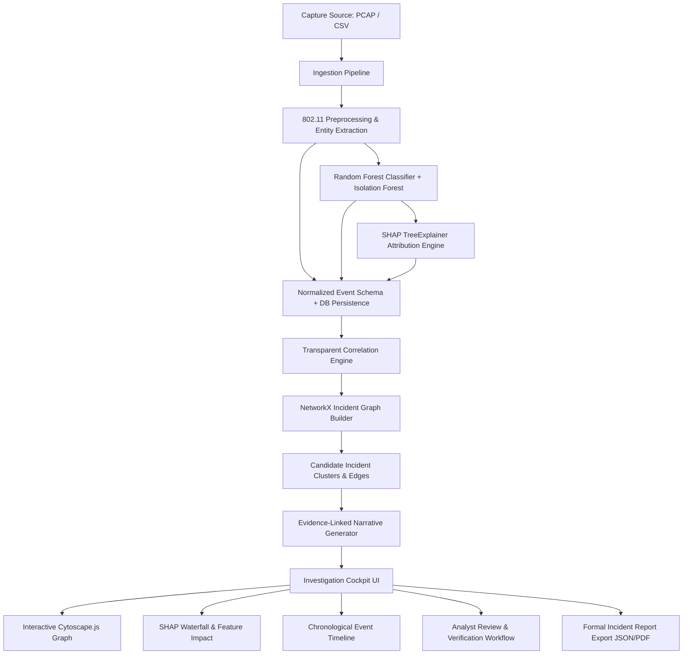

# Self-Explaining Wireless IDS Architecture

## 1. System Overview
The **Self-Explaining Wireless IDS** combines machine learning detection, feature attribution explainability (SHAP), rule-governed event correlation (NetworkX), and deterministic evidence-linked investigative narratives to accelerate SOC triage without making unwarranted causal leaps.

## 2. Seven-Stage Analysis Pipeline
1. **Ingestion**: Accepts raw 802.11 wireless PCAPs (via Scapy Dot11 parser) or pre-extracted feature CSV files. Generates a SHA-256 capture record.
2. **Preprocessing**: Normalizes 12 core 802.11 frame telemetry metrics (`frame_length`, `frame_type`, `frame_subtype`, `retry_flag`, `seq_num`, `signal_dbm`, `packet_rate`, `delta_time`, `auth_code`, `is_broadcast`, `channel`, `payload_entropy`). Extracts hardware entities (Transmitter MAC, Target Client MAC, BSSID, SSID, Channel).
3. **Detection Baseline**: Evaluates normalized feature vectors with a trained `RandomForestClassifier` (120 estimators, max depth 14). Concurrently computes `IsolationForest` anomaly scores to identify out-of-distribution patterns without falsely labeling them as attacks.
4. **Explainability Layer**: Computes local SHAP (SHapley Additive exPlanations) values for each prediction using `shap.TreeExplainer`, detailing positive and negative drivers against the baseline expected value.
5. **Correlation Engine**: Evaluates pairs of security alerts within a 90-second sliding window against explicit, transparent criteria:
   - Temporal proximity
   - Observable entity overlap (matching BSSID, target client MAC, or cloned SSID)
   - Behavioral compatibility (e.g., Deauth burst &rarr; Disassociation &rarr; Rogue AP beacon)
   - Rejects links between unrelated alerts occurring close in time on disjoint entities.
6. **Incident Graph Construction**: Represents events as nodes and validated correlation rules as typed edges in a `NetworkX` graph. Extracts connected components as candidate multi-event incidents or isolated alerts.
7. **Evidence-Linked Investigation**: Automatically drafts a structured narrative where every factual claim links to supporting event IDs (`[Event #ID]`), separates facts from hypotheses, and enumerates plausible benign alternatives (e.g., AP roaming, driver faults).

## 3. Technology Stack Summary
- **Backend API**: Python 3.11–3.14, FastAPI, Pydantic v2, Uvicorn, SQLAlchemy
- **Machine Learning & XAI**: scikit-learn (RandomForest, IsolationForest), SHAP
- **Graph & Networking**: NetworkX, Scapy (802.11 Dot11, RadioTap)
- **Database**: SQLite (default zero-config) / PostgreSQL (production)
- **Frontend Dashboard**: React 19, TypeScript, Vite, Tailwind CSS v4, Cytoscape.js, Lucide Icons
